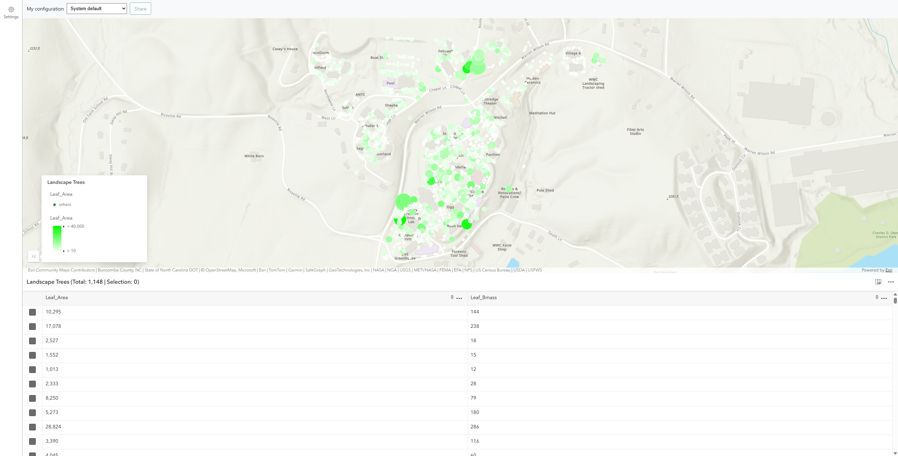
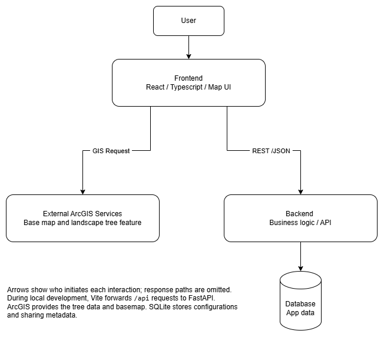

# Configurable Map

## Solution overview

Configurable Map lets you choose how the [Landscape Trees dataset](https://services.arcgis.com/V6ZHFr6zdgNZuVG0/arcgis/rest/services/Landscape_Trees/FeatureServer/0) looks on a map and which details appear in its table. You can save those choices as a named configuration and share a link so someone else can use the same settings. The app changes how the data is presented; it does not edit the tree records.

[](<Configurable Tree Demo Small.mp4>)

[Watch the video walkthrough — 1 min 31 sec, MP4](<Configurable Tree Demo Small.mp4>)

The app works as follows:

1. **Start with System default.** On launch, the app loads the predefined configuration from the backend. Its colours and sizes appear on the map, with `Leaf_Area` and `Leaf_Bmass` in the table.
2. **Choose how the map and table look.** Open **Settings** to change point colours and sizes. Click visible column chips to hide them, add columns from the hidden list, and drag their grips to change the table order. Keyboard users can focus a grip and press Alt + Left/Right.
3. **Apply your changes.** **Apply settings** updates the view and keeps the drawer open. Changing only symbology preserves the table layout. Apply does not save; closing the drawer keeps your draft for the current page session.
4. **Save a named configuration.** **Save as configuration** checks the current draft, asks for a name, then saves through the API and applies the settings. Apply is not required first. A brief success alert confirms creation, and the new name appears in the selector.
5. **Load a saved configuration.** Your saved configurations remain available after refreshing the page or restarting the app. Choose one from the dropdown above the map to apply its saved point colours, point sizes, and visible table columns in their saved order.
6. **Share a saved configuration.** Choose a saved configuration, click **Share**, then **Publish link**. Copy the link to share it with someone else. Opening the link applies the configuration's saved map and table settings, and the dropdown labels it as shared. Changes you have not saved are not included. Viewing a shared configuration does not add it to the recipient's saved configurations.

- **Symbology:** Point colours represent leaf area and sizes represent leaf biomass; those fields and their data ranges stay fixed.
- **Table columns:** At least one column must remain visible.
- **Configuration names:** Names must be unique for the same owner, ignoring case and surrounding spaces.
- **Validation:** Invalid settings or duplicate names show an error so the user can correct them.

### Try the shared examples

After following the [local setup instructions](#local-setup-instructions) and starting the app, open either link below to try a shared configuration. These examples are included with the app and belong to another demo user (`demo-share`). Opening a link applies its map and table settings without adding the example to your saved configurations.

| Shared example                                                                                           | What to look for                                                                                                                                    |
| -------------------------------------------------------------------------------------------------------- | --------------------------------------------------------------------------------------------------------------------------------------------------- |
| [Tree Identity and Condition](http://127.0.0.1:5173/?share=RfYTCzDAO0YBTDuFBjuG7rUmpzMaSWY3hHlaAQbtx4c)  | Tree identity, condition, age, height and notes alongside leaf measurements. Pale-to-dark blue points, with marker sizes from 6 to 24 points.       |
| [Leaf and Carbon Measurements](http://127.0.0.1:5173/?share=YRJH15Pu9ye3ik4q736OzqziDVa6GKLMfxfH13rePR4) | Leaf measurements, carbon storage and sequestration, native status and land use. Pale-to-dark purple points, with marker sizes from 8 to 36 points. |

Both examples still use leaf area for colour and leaf biomass for size. Their column selections support different ways of looking at the same dataset.

These two example links stay the same, even after resetting the database. Your own configurations receive a randomly generated link when first published, and restarting the app does not change it. To try the examples, start the app on your computer: `127.0.0.1` points to the computer opening the link. If you use a different frontend port, replace `5173` in the URL. To share your own configurations with someone on another computer, the frontend and backend must be hosted at an address they can access.

### Design approach

I wanted the map to remain the focus, with settings available when needed. The left rail opens one drawer rather than placing separate controls across the map. Column chips make the current selection visible, while a separate hidden-column group keeps the remaining choices searchable.

The interface uses a restrained [colour palette](docs/COLOUR_PALETTE.md):

| Role           | Colour                   |
| -------------- | ------------------------ |
| Background     | Cool off-white `#F7F9FA` |
| Panels         | White `#FFFFFF`          |
| Main text      | Slate `#203039`          |
| Secondary text | `#586874`                |
| Primary action | Deep teal `#176B63`      |
| Selected state | Pale teal `#E8F3F0`      |

The filled teal **Apply settings** button draws attention to updating the map and table. The outlined **Save as configuration** button offers a separate action for saving settings to use later. Status text tells users whether their changes have been applied or saved, while error messages explain what needs correcting. Changing point colours does not affect the colours of buttons and panels. The drawer currently covers part of the map and table when open. Future improvements include making the map and table resize beside the drawer and adapting the interface for mobile screens.

## Architecture explanation

[](docs/images/ura-architecture.drawio.png)

The frontend is a React/TypeScript app built with Vite. React manages the settings and user actions; ArcGIS components provide the map, legend and attribute table. The browser reads tree data directly from ArcGIS rather than copying it into the application database.

The Python/FastAPI backend validates configurations and reads or writes them through a SQLite repository. During local development, Vite forwards `/api` requests to FastAPI. SQLite stores configuration settings, names, ownership and sharing metadata in `apps/api/data/configurations.db`. The file is created on startup and is not committed.

| Table            | Stored data and purpose                                                                                                                                                                                                                                                                    |
| ---------------- | ------------------------------------------------------------------------------------------------------------------------------------------------------------------------------------------------------------------------------------------------------------------------------------------ |
| `configurations` | Stores one record per configuration, including its ID, name, owner, `visibility` (`private` or `unlisted`), share token and creation time. `settings_json` holds the point colour and size settings, plus the visible table columns in display order. Columns not in this list are hidden. |
| `user_defaults`  | Reserved for a future feature that lets users choose which configuration loads at startup. Each `user_id` can be linked to one `configuration_id`, allowing one default per user. The current app does not use this table.                                                                 |

The fields stored in `configurations` are:

| Field           | Meaning                                                                                                                                                                                    |
| --------------- | ------------------------------------------------------------------------------------------------------------------------------------------------------------------------------------------ |
| `id`            | Unique identifier for the configuration. The backend generates a UUID for each new custom configuration; seeded configurations have fixed IDs.                                             |
| `name`          | Display name shown in the configuration selector. Names must be unique for the same owner, ignoring case and surrounding spaces.                                                           |
| `owner_id`      | Identifies the owner. The backend uses `demo-user` for new custom configurations, `system` for System default and `demo-share` for the shared examples. Login is not implemented.          |
| `visibility`    | Starts as `private` for a new custom configuration. Clicking **Publish link** changes it to `unlisted`, allowing anyone with the link to load it without listing it in a public catalogue. |
| `share_token`   | Unique value used in the `?share=...` link. It is empty (`NULL`) until publication, then generated and reused on later publications. The two seeded demo examples use fixed tokens.        |
| `settings_json` | Stores the point colour and size settings and the visible table columns in their display order.                                                                                            |
| `created_at`    | Date and time the record was created, stored in UTC.                                                                                                                                       |

Custom configurations remain private until published. The current app does not let users change a published configuration back to private; unsharing is future work.

FastAPI's Pydantic models validate incoming settings and trim configuration names. SQLite enforces case-insensitive name uniqueness for each owner and unique share tokens. These checks protect saved data even when a request bypasses the frontend.

Database initialization inserts System default and the two demo shares only when their IDs are missing, preserving existing records. The frontend loads System default through the API, or the shared configuration when the URL contains a share token. It waits for both the settings and the ArcGIS layer before configuring the view; it has no separate frontend default.

The frontend keeps the draft, applied settings and saved record separate: editing a control, applying it and saving it are different actions. **Apply settings** updates only the map or table settings that changed, without saving them to the database. For example, a colour-only change leaves the table layout untouched. **Save as configuration** saves the current draft, then applies both its symbology and table settings. Loading a saved configuration also applies both.

The main code is under `apps/web/src` and `apps/api/app`. Frontend components provide the drawer and dialogs. `configurationApi.ts` sends configuration requests to the backend and handles responses and errors. `configuration.ts` applies settings to ArcGIS by updating point colours and sizes, column visibility and column order. Backend routes define the endpoints, models validate request data, and `repository.py` handles SQL and transactions.

The [API documentation](#api-documentation) describes the endpoints and error responses. [Assumptions and trade-offs](#assumptions-and-trade-offs) explains why these choices fit the demo and what they leave for future work.

## Local setup instructions

Use Node.js 24 (tested with 24.16.0), pnpm and Python 3.11 (tested with 3.11.2). Run the following from the repository root in PowerShell.

**One-time frontend setup — PowerShell, from the repository root:**

```powershell
pnpm --dir apps/web install
```

**One-time backend setup — PowerShell, from the repository root:**

```powershell
python -m venv apps/api/.venv
.\apps\api\.venv\Scripts\python.exe -m pip install -r apps/api/requirements-dev.txt
```

**Start frontend and backend together — PowerShell, from the repository root:**

```powershell
powershell -ExecutionPolicy Bypass -File .\scripts\dev.ps1
```

Open the frontend URL printed by the command, normally [http://127.0.0.1:5173](http://127.0.0.1:5173). Ctrl+C stops both servers. Frontend changes reload automatically; restart the command after Python changes. Internet access is needed for ArcGIS.

If a previous server is still using the ports, stop that instance first, or append `-WebPort 5174 -ApiPort 8001` to the command.

### Optional: reset local data

To start with a fresh database, stop the running servers, then run these commands from the repository root. **This deletes your saved custom configurations and their share links.** Startup recreates System default and the two demo examples; their fixed demo links still work. A reset is unnecessary for ordinary startup.

**Reset and restart — PowerShell, from the repository root:**

```powershell
Remove-Item -LiteralPath .\apps\api\data\configurations.db
powershell -ExecutionPolicy Bypass -File .\scripts\dev.ps1
```

### Tests and build

**Frontend tests and build — PowerShell, from the repository root:**

```powershell
pnpm --dir apps/web test
pnpm --dir apps/web run build
```

**Backend tests — PowerShell, from `apps/api`:**

```powershell
./.venv/Scripts/python.exe -m unittest discover -s tests -v
```

**Automated checks:** The frontend and backend tests, TypeScript checks and production build passed during development. The build warned about large JavaScript files. Backend tests use temporary databases, so they do not change saved configurations.

**Browser checks:** Saving drafts, duplicate-name errors, loading saved configurations and opening shared links were checked in the browser. Automated App tests use simulated ArcGIS objects, so they do not verify real map rendering or drag behaviour.

**Remaining checks:** Confirm that changing only point colours or sizes preserves the table layout, then test column reordering and keyboard controls in the running app. Mobile and full accessibility testing are still pending.

## API documentation

With the backend running, open the [interactive FastAPI documentation](http://127.0.0.1:8000/api/docs) for request bodies, response schemas and examples. The [OpenAPI definition](http://127.0.0.1:8000/api/openapi.json) is available too.

| Method and route                         | Purpose                                                    | Success status                     | Handled errors                                           |
| ---------------------------------------- | ---------------------------------------------------------- | ---------------------------------- | -------------------------------------------------------- |
| `GET /api/health`                        | Check that the API process responds.                       | `200 OK`                           | —                                                        |
| `POST /api/configurations`               | Create a private named configuration.                      | `201 Created`                      | `409` duplicate name; `422` invalid request.             |
| `GET /api/configurations`                | List the demo user's saved configurations.                 | `200 OK`, including an empty list. | —                                                        |
| `GET /api/configurations/default`        | Get System default from SQLite.                            | `200 OK`                           | `404` default record missing.                            |
| `GET /api/configurations/{id}`           | Get a configuration owned by the demo user.                | `200 OK`                           | `404` missing or owned by someone else.                  |
| `POST /api/configurations/{id}/share`    | Publish an owned configuration and return its share token. | `200 OK`                           | `404` missing, owned by someone else, or System default. |
| `GET /api/configurations/shared/{token}` | Get a published configuration using its token.             | `200 OK`                           | `404` unknown token or configuration not published.      |

A create request supplies `name` and `configuration`, containing `symbolConfig` and `tableConfig`. The server assigns the ID, owner, timestamp and initial visibility. Validation rejects unsupported fields/ranges, invalid colours or sizes, and empty, duplicate or unknown column names.

The health endpoint returns HTTP `200 OK` with the JSON body `{"status":"ok"}`. It checks the API process, not database or ArcGIS availability. Publishing the same record again returns `200 OK` with the same token. Update and delete endpoints are outside the assignment scope.

## Assumptions and trade-offs

I built this as a local desktop demonstration using the Landscape Trees dataset from ArcGIS. The following choices keep that scope manageable, with trade-offs I would revisit as the application grows.

| Choice                                                 | Reason                                                                                                                                                                                                                                                                                                                                 | Trade-off                                                                                                                                                                                               |
| ------------------------------------------------------ | -------------------------------------------------------------------------------------------------------------------------------------------------------------------------------------------------------------------------------------------------------------------------------------------------------------------------------------- | ------------------------------------------------------------------------------------------------------------------------------------------------------------------------------------------------------- |
| Reuse the existing ArcGIS map and table                | The existing ArcGIS map and table already display the tree data and support selection. I added controls for point colours and sizes, and for showing, hiding and reordering table columns, while keeping their built-in interface styling. This met the functional needs without replacing either component or adding another library. | Customisation depends on what the ArcGIS components support. Real map rendering and interactions still need browser checks alongside automated tests.                                                   |
| Apply the new colour palette to newly added components | The settings drawer, dialogs, buttons and alerts follow the new palette to give the configuration controls a consistent appearance. Existing ArcGIS components retain their original styling.                                                                                                                                          | The new controls and built-in ArcGIS widgets can look different. Applying a consistent theme across the entire interface would require further styling work.                                            |
| Use React’s built-in state management                  | The settings belong to one main screen. React state tracks the draft, applied settings and saved configuration without introducing another state-management library.                                                                                                                                                                   | `App.tsx` coordinates several workflows, including startup, saving, loading and sharing. Separating these workflows into smaller modules would help as the app grows.                                   |
| Use Python and FastAPI                                 | FastAPI validates incoming requests and generates interactive API documentation. This makes the expected request format and validation errors easier to inspect.                                                                                                                                                                       | The frontend and backend use different languages. Both must agree on the configuration format and validation rules, so changes to these need to be coordinated across both systems.                     |
| Use SQLite and direct SQL                              | Saved configurations need to remain available after restarting the app. SQLite provides this without a separate database server. The app only needs a small set of straightforward queries, so I used direct SQL without adding an ORM.                                                                                                | There is no migration process yet for changing the database tables while preserving existing configurations. Production deployment and load testing are also outside the current setup.                 |
| Store symbology and table settings together as JSON    | A configuration contains both the map’s colour and size settings and the table’s visible columns and order. Saving them together as JSON lets the app save and load the complete configuration without joining separate tables.                                                                                                        | Searching for an individual setting, such as a particular point colour, requires looking inside the JSON. If the JSON format changes later, older saved configurations may need to be updated to match. |
| Store visible columns as an ordered array              | The list records both which columns are visible and their display order. Columns missing from the list are hidden, so a separate visibility flag is unnecessary.                                                                                                                                                                       | New dataset columns stay hidden in existing configurations until the user adds them.                                                                                                                    |
| Store one System default in SQLite                     | One record provides the app’s starting settings without creating a separate default for every user. Its settings can be changed in the database without deploying new application code.                                                                                                                                                | System default is loaded from the API. There is no admin screen for editing it, so changing the existing default requires a database update.                                                            |
| Share configurations through unlisted links            | A link lets someone open the saved map and table settings directly, without a public catalogue or invitation process.                                                                                                                                                                                                                  | Anyone with the link can access the settings. Making a published configuration private again and saving a personal copy are not implemented.                                                            |
| Limit marker sizes to 1–100 points                     | I chose this range for readability. Equal and reversed size ramps are allowed. Users can change point colours, sizes, or both. Each saved configuration stores both the colour and size settings so they can be restored together.                                                                                                     | Sizes outside this range are rejected. With equal sizes, point size no longer shows biomass differences. With reversed sizes, higher biomass values appear as smaller points.                           |

## Known limitations

- **Demo identity:** all browsers currently use the same `demo-user`. Ownership checks exist, but there is no login or separation between real people using the demo.
- **Fixed symbol fields:** colours use `Leaf_Area` at 10 and 40,000; sizes use `Leaf_Bmass` at 0 and 700. You can change the endpoint colours and marker sizes, but not the fields or data ranges.
- **Saved settings:** map position, selection, column widths and native table sorting are not saved. Refreshing the page clears any unsaved changes and loads System default. If the current URL is a shared link, it reloads that shared configuration instead.
- **Defaults and sharing:** personal defaults, unsharing and saving shared copies are not implemented. The `user_defaults` table is reserved for a future feature that lets users choose which configuration loads at app startup. The app does not use this table yet. A shared configuration saves the colours, point sizes and table columns. The tree records still come from ArcGIS. Shared links use the latest tree data available from ArcGIS, with the saved display settings applied.
- **Interface:** The inherited legend includes an “others” entry alongside the colour ramp that needs clearer labelling or removal.
- **Deployment:** the app is set up for local use. Docker setup was deferred due to time constraints. It does not include real user login or production hosting setup, and has not been tested with many simultaneous users. Saved configuration lists are loaded in full, which may become inefficient as they grow. Database structure changes currently require manual handling to preserve existing records. Direct Python dependencies have fixed versions, but the additional packages they depend on may differ between installations.

## Further improvements

### Planned improvements

- **Future: Layout and accessibility.** Dock the drawer so the map and table resize beside it, keeping the table horizontally scrollable. Add mobile responsiveness and complete keyboard, screen-reader and contrast checks.
- **Future: Accounts and configurations.** Add login, personal startup defaults, the ability to revoke shared links, and saving shared settings as a separate owned configuration.
- **Future: Testing and maintenance.** Add automated browser tests for map rendering, column reordering and dialog focus. Introduce migration scripts to update the database structure while preserving saved configurations.

### Code extension notes

Comments prefixed with `Future:` describe possible extensions beside the relevant code. These include choosing different symbology fields or data ranges, supporting other datasets, replacing icons, and extending configuration ownership and sharing. Search the repository for `Future:` to find these notes.

## AI usage disclosure

**Tools used**

I used OpenAI Codex, with Sol agents for implementation and Astra for review.

**What I used AI for**

AI generated substantial parts of the frontend, backend, tests and documentation. I also used it to explain unfamiliar code, compare approaches and review changes. Repository instructions in AGENTS.md guided the agents, while a local BUILD_DECISIONS.md recorded agreed scope and decisions. I worked through the assignment one feature at a time using prompts, feedback, code review and manual testing. I did not ask agents to generate a specification from a template before implementing the code.

**One suggestion I accepted**

I accepted storing symbology and table settings together as JSON in one configuration record. I initially considered separate tables, but these settings are saved and loaded together, so keeping them together avoided unnecessary joins.

**One suggestion I changed**

AI suggested defining System default in a backend file and returning it through the API. I chose a shared SQLite record instead, so the existing default can be changed in the database without redeploying the application. This adds database setup and maintenance work.

**How I verified the implementation**

I manually tested the running app during development and reviewed the resulting behaviour. Codex ran frontend and backend tests and a production build, which includes TypeScript type checking. It also performed browser checks of saving and sharing. App tests simulate ArcGIS objects, so they do not establish that real map rendering or drag interactions work correctly. Remaining checks are documented under [**Tests and build**](#tests-and-build).
